# Dependency-Aware Debugger Architecture

## Product objective

The product turns OpenTelemetry signals from a distributed application into an
evidence-backed debugging decision:

1. detect a real incident rather than a single noisy measurement;
2. reconstruct the dependency path active during the incident;
3. rank the service, resource, or dependency edge that best explains it;
4. expose the observations that support and contradict each candidate; and
5. attach a reviewed diagnostic and remediation runbook.

It is not a generic observability data lake, an LLM assistant, or an autonomous
remediation system. PostgreSQL is the durable implementation layer, not the
product's organizing idea.

## Runtime flow

```mermaid
flowchart LR
    App[Instrumented target system] -->|OTLP| Gateway[OTel gateway]
    Gateway -->|OTLP/HTTP protobuf| API[Telemetry API]
    API --> Raw[(Normalized telemetry)]
    Raw --> Analytics[Analytics worker]
    Analytics --> Context[Incident context + temporal graph]
    Context --> Ranker[RCA ranker]
    Ranker --> Evidence[Evidence + runbook selection]
    Evidence --> ReadModels[(Incident read models)]
    ReadModels --> Grafana[Grafana]
    Grafana --> Feedback[Developer feedback]
    Feedback --> ReadModels
```

### Telemetry gateway

The gateway receives OTLP/gRPC and OTLP/HTTP. It batches, retries, and forwards
protobuf payloads to the API. When the OpenTelemetry Demo is used, the gateway
may additionally forward signals to the upstream demo collector so its normal
observability stack continues to work.

### Telemetry API

The API decodes OTLP resource, scope, and data-point structures, normalizes
identities, and writes signal-specific records. Idempotency keys make collector
retries safe. Invalid payloads are quarantined with a reason instead of being
silently discarded.

The same service exposes read-only incident, graph, candidate, and evidence
endpoints plus a feedback endpoint. Grafana normally reads the equivalent
PostgreSQL views directly.

### Analytics worker

The worker advances fixed event-time buckets. It derives:

- request volume, error rate, and duration quantiles;
- resource utilization and saturation;
- log severity and template-frequency changes;
- observed service-to-service and service-to-resource edges;
- missingness and signal-quality indicators; and
- robust anomaly and onset scores relative to healthy history.

Detection uses an explicit feature contract: errors and latency have the
highest weight, while request volume, CPU, and memory require stronger,
sustained departures. Raw receiver series remain stored in feature buckets for
evidence and offline work, but arbitrary `metric.*` values are opt-in because
many are cumulative counters whose absolute values rise normally over time.
An incident opens only after a configurable persistence rule is met. The local
deployment defaults to two consecutive closed 10-second abnormal buckets. This
still rejects a one-bucket spike, while preserving real bursts from low-QPS
services such as the Demo payment service; operators can tune the requirement
with `RCA_MIN_INCIDENT_BUCKETS`.

### Root-cause engine

Candidates can be a service, service instance, dependency edge, database,
queue, cache, host, external workload, or `no_fault`. Ranking uses temporal
precedence, topology, anomaly magnitude, path coverage, signal quality, and
learned incident patterns.

The always-available ranker is transparent and deterministic. The currently
deployable learned path is a tabular candidate re-ranker trained from exact
online feature snapshots. A numeric temporal Transformer plus edge-aware graph
attention forward architecture exists as research code, but it is not yet a
trainable or deployable challenger: sequence/graph export, loss/training,
serialization, and worker inference integration remain future work. Promotion
is an explicit reviewed action after held-out metrics are inspected; checksum
and lifecycle guards do not substitute for a quality-regression gate.

### Evidence and runbooks

Every ranked candidate is accompanied by concrete telemetry, its onset time,
the affected dependency path, and limitations. Raw attention weights are not
treated as causal proof. Runbooks are reviewed data records with diagnostic,
remediation, verification, and rollback steps; the system never generates or
executes an arbitrary fix.

## Storage boundaries

The OpenTelemetry Demo's `astronomy-db` is part of the observed target and may
itself be faulted. The debugger therefore uses a separate `rca-db` PostgreSQL
service. This prevents a database experiment from taking the debugger down or
allowing debugger writes to influence target metrics.

Main storage groups:

- raw signals: `spans`, `metric_points`, `log_records`, `rejected_records`;
- derived context: `dependency_edges`, `feature_buckets`, `baselines`;
- decisions: `incidents`, `candidate_rankings`, `evidence_items`;
- guidance: `runbooks`, `recommendations`, `developer_feedback`; and
- reproducibility: `experiment_runs`, `fault_injections`,
  `ground_truth_labels`, `dataset_snapshots`, `model_versions`.

## Availability and degradation

- Collector retries and API idempotency handle transient ingestion failure.
- Rejected records and per-signal freshness are visible in Grafana.
- Missing modalities are represented explicitly; missing values are never
  silently interpreted as healthy zeros.
- If no candidate exceeds calibrated confidence, the result is
  `inconclusive` and the dashboard presents the evidence for manual debugging.
- The heuristic ranker remains available if a model artifact cannot load.
- Neither model inference nor Grafana is on the application's request path.

## Trust boundaries

- The target system only pushes telemetry to the collector.
- Grafana uses a read-oriented datasource and never controls the target.
- Experiment ground truth is stored separately and excluded from features.
- The `emitRawPii` OpenTelemetry Demo flag remains disabled.
- Remediation is advisory; a human reviews and performs any operational action.
