# Dependency-Aware Debugger Architecture

## Product objective

The product turns OpenTelemetry signals from a distributed application into an
evidence-backed debugging decision:

1. detect a real incident rather than a single noisy measurement;
2. reconstruct the dependency path active during the incident;
3. rank the service, resource, or dependency edge that best explains it;
4. expose the observations that support and contradict each candidate; and
5. attach a reviewed diagnostic and remediation runbook.

It is not a generic observability data lake, an LLM assistant, or an autonomous
remediation system. PostgreSQL is the durable implementation layer, not the
product's organizing idea.

## Runtime flow

```mermaid
flowchart LR
    App[Instrumented target system] -->|OTLP| Gateway[OTel gateway]
    Gateway -->|OTLP/HTTP protobuf| API[Telemetry API]
    API --> Raw[(Normalized telemetry)]
    Raw --> Analytics[Analytics worker]
    Analytics --> Context[Incident context + temporal graph]
    Context --> Ranker[DoWhy GCM latency attribution]
    Ranker -->|unsupported or insufficient data| Fallback[Heuristic diagnosis]
    Fallback --> Evidence
    Ranker --> Evidence[Evidence + runbook selection]
    Evidence --> ReadModels[(Incident read models)]
    ReadModels --> Grafana[Grafana]
    Grafana --> Feedback[Developer feedback]
    Feedback --> ReadModels
```

### Telemetry gateway

The gateway receives OTLP/gRPC and OTLP/HTTP. It batches, retries, and forwards
protobuf payloads to the API. When the OpenTelemetry Demo is used, the gateway
may additionally forward signals to the upstream demo collector so its normal
observability stack continues to work.

### Telemetry API

The API decodes OTLP resource, scope, and data-point structures, normalizes
identities, and writes signal-specific records. Idempotency keys make collector
retries safe. Invalid payloads are quarantined with a reason instead of being
silently discarded.

The same service exposes read-only incident, graph, candidate, and evidence
endpoints plus a feedback endpoint. Grafana normally reads the equivalent
PostgreSQL views directly.

### Analytics worker

The worker advances fixed event-time buckets. It derives:

- request volume, error rate, and duration quantiles;
- resource utilization and saturation;
- log severity and template-frequency changes;
- observed service-to-service and service-to-resource edges;
- missingness and signal-quality indicators; and
- robust anomaly and onset scores relative to healthy history.

Detection uses an explicit feature contract: errors and latency have the
highest weight, while request volume, CPU, and memory require stronger,
sustained departures. Raw receiver series remain stored in feature buckets for
evidence and offline work, but arbitrary `metric.*` values are opt-in because
many are cumulative counters whose absolute values rise normally over time.
An incident opens only after a configurable persistence rule is met. The local
deployment defaults to two consecutive closed 10-second abnormal buckets. This
still rejects a one-bucket spike, while preserving real bursts from low-QPS
services such as the Demo payment service; operators can tune the requirement
with `RCA_MIN_INCIDENT_BUCKETS`.

### Root-cause engine

`RCA_ANALYSIS_ENGINE=dowhy` selects the existing MIT-licensed DoWhy GCM
implementation for latency attribution. The adapter observes warm-up and incident
buckets, selects aligned healthy observations strictly before incident onset,
and fits DoWhy's built-in causal mechanisms. No experiment label or injected
fault identity enters this fit.

For synchronous latency propagation, a dependency's latency influences its
caller, so the service-call arrows are reversed. The adapter uses the target
service's causal ancestor subgraph and refuses unsupported topology, cycles,
missing observations, insufficient history, and unsupported incident types.
These restrictions are explicit modeling assumptions; an observed call graph
does not establish causal sufficiency.

Successful results store signed causal attribution scores and supporting
context, with `probability=NULL`. The selected incident's
`metadata.analysis` records the provider, execution status, reason, target,
baseline sample count, and assumptions. The actual engine/version is retained
on the incident and candidates. A heuristic fallback keeps its own version and
records why DoWhy could not analyze the incident.

The heuristic ranks observable services and dependency edges using temporal
precedence, anomaly magnitude, path coverage, and data quality. The separately
selectable `champion` mode retains the historical tabular candidate re-ranker.
Its manual promotion and checksum guards remain available for comparison.
Transformer/graph-attention forward code is research scaffolding; completing
that training/deployment pipeline is outside the DoWhy integration. See
[the integration contract](DOWHY_INTEGRATION.md).

### Evidence and runbooks

Every ranked candidate is accompanied by concrete telemetry, its onset time,
the affected dependency path, and limitations. Raw attention weights are not
treated as causal proof. Runbooks are reviewed data records with diagnostic,
remediation, verification, and rollback steps; the system never generates or
executes an arbitrary fix.

## Storage boundaries

The OpenTelemetry Demo's `astronomy-db` is part of the observed target and may
itself be faulted. The debugger therefore uses a separate `rca-db` PostgreSQL
service. This prevents a database experiment from taking the debugger down or
allowing debugger writes to influence target metrics.

Main storage groups:

- raw signals: `spans`, `metric_points`, `log_records`, `rejected_records`;
- derived context: `dependency_edges`, `feature_buckets`, `baselines`;
- decisions: `incidents`, `candidate_rankings`, `evidence_items`;
- guidance: `runbooks`, `recommendations`, `developer_feedback`; and
- reproducibility: `experiment_runs`, `fault_injections`,
  `ground_truth_labels`, `dataset_snapshots`, `model_versions`.

## Availability and degradation

- Collector retries and API idempotency handle transient ingestion failure.
- Rejected records and per-signal freshness are visible in Grafana.
- Missing modalities are represented explicitly; missing values are never
  silently interpreted as healthy zeros.
- Insufficient evidence produces an explicit inconclusive or fallback result;
  the dashboard shows the actual engine and the reason. Attribution scores are
  not converted into probabilities.
- The heuristic remains available if DoWhy cannot analyze the input or a
  separately selected tabular artifact cannot load.
- Neither model inference nor Grafana is on the application's request path.

## Trust boundaries

- The target system only pushes telemetry to the collector.
- Grafana uses a read-oriented datasource and never controls the target.
- Experiment ground truth is stored separately and excluded from features.
- The `emitRawPii` OpenTelemetry Demo flag remains disabled.
- Remediation is advisory; a human reviews and performs any operational action.
